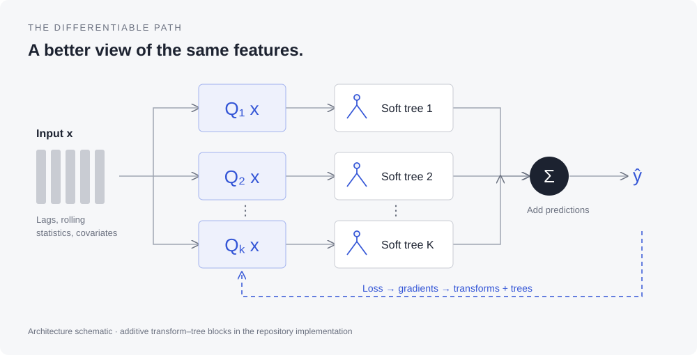

# BSDT-Q

### Soft Gradient Boosting With Learnable Feature Transforms for Sequential Regression

**Huseyin Karaca · Suleyman Serdar Kozat**  
Bilkent University · *IEEE Signal Processing Letters*, **33**, 186–190, 2026

[](https://doi.org/10.1109/LSP.2025.3639345)
[](https://doi.org/10.24433/CO.9409420.v1)

BSDT-Q combines boosted soft decision trees with learnable linear feature transforms for sequential regression, with a focus on settings where training data is scarce and the feature space is large.

[Paper](https://doi.org/10.1109/LSP.2025.3639345) · [Reproduce on Code Ocean](https://codeocean.com/capsule/9934558/tree/v1) · [Project website](https://hkaraca.com/bsdtq/) · [Citation](#citation)



## Why BSDT-Q?

Sequential prediction often starts with a large collection of lagged values, rolling statistics, and exogenous variables. With few observations, redundant features make fitting a reliable predictor difficult.

BSDT-Q learns a linear transform **Q** within the boosting framework. Soft, probabilistic tree routing lets gradients flow through the tree to the transform, allowing the representation and predictor to adapt together. A linear transform keeps the representation lightweight; the trees model nonlinear relationships. The paper also explores an MLP transform as a more flexible alternative.

The paper describes residual-based boosting in Algorithm 1. In this repository, `BoostedSDTR` implements an additive ensemble of transform–tree blocks and optimizes them jointly through the total prediction loss. See the [reproduction notes](docs/reproducibility.md) for this implementation distinction.

## Published results

Test MSE from **Table II of the published article**; lower is better. M4 denotes the quarterly subset. Results are reported at the paper's printed precision, not newly executed benchmarks.

| Model | M4 | Weather | Exchange | ETTm2 | Synthetic |
| :--- | ---: | ---: | ---: | ---: | ---: |
| **BSDT-Q** | **0.564** | **6.90e-5** | **4.95e-4** | **4.34e-3** | **1.14** |
| BSDT-MLP | 0.924 | 8.27e-5 | 1.95e-3 | 1.01e-2 | 1.22 |
| CatBoost | 0.997 | 1.22e-4 | 3.99e-3 | 6.41e-3 | 1.46 |
| LSTM | 0.661 | 1.54e-4 | 1.71e-3 | 5.85e-3 | 1.28 |
| Lasso | 0.760 | 2.81e-4 | 7.74e-3 | 1.11e-2 | 1.26 |
| LightGBM | 0.848 | 1.10e-4 | 8.23e-3 | 6.92e-3 | 1.71 |
| Random Forest | 0.749 | 9.88e-5 | 1.60e-3 | 8.87e-3 | 1.32 |
| SDT | 0.902 | 1.28e-4 | 5.91e-4 | 1.01e-2 | 1.26 |
| XGBoost | 0.774 | 1.00e-4 | 9.19e-4 | 1.06e-2 | 1.43 |

BSDT-Q has the lowest reported MSE on all five datasets, including both ablations. Each dataset uses its own target scale; compare models within a column. [Download CSV](docs/data/results.csv) · [Data provenance](docs/data/README.md).

> The table above follows the published IEEE article and uses ETTm2.

## Reproduce the paper

Use the **versioned Code Ocean capsule** for the archived reproducibility package:

**[Open capsule v1 →](https://codeocean.com/capsule/9934558/tree/v1)**  
Software DOI: [10.24433/CO.9409420.v1](https://doi.org/10.24433/CO.9409420.v1)

Open the capsule, inspect its documented run instructions and preserved environment, and run the supplied workflow. The archive DOI is distinct from the article DOI. Registration metadata verifies the capsule's title, authors, and version; the capsule has not been re-executed as part of this documentation update.

For experiments and extensions in this GitHub checkout, see below. Its convenience requirements are unpinned and are **not** a replacement for the capsule environment.

## Local setup

Use a Python virtual environment with a compatible PyTorch installation. Python 3.11 or 3.12 is a reasonable starting point; this repository does not specify an original Python version or lockfile.

```bash
git clone https://github.com/huseyin-karaca/bsdtq.git
cd bsdtq
python3 -m venv .venv
source .venv/bin/activate
python -m pip install -r requirements.txt
```

On Windows, activate with `.venv\Scripts\activate`. The experiment runners include all comparison models, so their imports require the baseline dependencies too.

### Run experiments

Run from the repository root:

```bash
# Synthetic data: generated locally, no dataset download needed
python clean_synt.py

# Real-world benchmarks: configure dataset directories first
python clean_m4.py
python clean_weather.py
python clean_exchange.py
python clean_ett.py
```

Before running the real-data scripts, replace the hard-coded `/Users/huseyinkaraca/Documents/datasets` directory in each runner with your own writable dataset cache. The scripts use `datasetsforecast` loaders; initial loading may download the data. Despite its filename, `clean_ett.py` selects **ETTm2**.

Each runner performs hyperparameter search and prints evaluation and dataset statistics. Search spaces are defined in `clean_configs.py`; budgets, horizons, features, and seeds are defined in each runner. These are research experiments and can take substantially longer than a model forward pass.

```bash
# Run all benchmarks (or load cached results) and export LaTeX tables
python clean_tables.py
```

This writes three `all_*.pkl` caches in the working directory and tables under `manuscript/table_figures/`. If you change configurations, move the three old caches aside before regenerating tables. Importing `clean_tables.py` also starts this workflow, so use it as a script. See [reproducibility notes](docs/reproducibility.md) for methodological details and limitations.

## Repository guide

| Path | Purpose |
| :--- | :--- |
| [`bsdtq.py`](bsdtq.py) | Additive transform–tree ensemble, skorch wrapper, dataset adapter, loss, time split |
| [`single_sdt.py`](single_sdt.py) | Differentiable soft decision tree regressor |
| [`lstm_model.py`](lstm_model.py) | LSTM comparison model |
| [`clean_configs.py`](clean_configs.py) | Hyperparameter search spaces and forecasting configuration |
| `clean_{synt,m4,weather,exchange,ett}.py` | Dataset-specific experiment entry points |
| [`clean_tables.py`](clean_tables.py) | Experiment caching and LaTeX table export |
| [`old_codes/`](old_codes/) | Earlier exploratory implementations |
| [`docs/`](docs/) | Static research website, editable SVG figure, results, and reproduction notes |

## Project website

The site is buildless HTML, CSS, and JavaScript in `docs/`, styled to complement [HIT-ASR](https://hkaraca.com/hit-asr/). It includes a method explanation, published results, baseline comparison, reproduction links, and downloadable BibTeX.

```bash
python3 -m http.server 8000 --directory docs
# Open http://localhost:8000
```

All local assets use relative paths, so `docs/` can be served under `/bsdtq/` on hkaraca.com. A manual GitHub Pages workflow is included in [`.github/workflows/pages.yml`](.github/workflows/pages.yml). Enable GitHub Pages with **GitHub Actions** as the source, then run **Deploy research website**. Your account’s main GitHub Pages site already uses `hkaraca.com`, so this project site will inherit `https://hkaraca.com/bsdtq/`, just as HIT-ASR does. No DNS change or project-level `CNAME` is needed. Project URL: https://hkaraca.com/bsdtq/. [Website maintenance guide](docs/README.md).

## Citation

```bibtex
@article{karaca2026soft,
  author  = {Huseyin Karaca and Suleyman Serdar Kozat},
  title   = {Soft Gradient Boosting With Learnable Feature Transforms for Sequential Regression},
  journal = {IEEE Signal Processing Letters},
  volume  = {33},
  pages   = {186--190},
  year    = {2026},
  doi     = {10.1109/LSP.2025.3639345}
}
```

When referencing the archived software, also cite [Code Ocean capsule v1](https://doi.org/10.24433/CO.9409420.v1). [Download both BibTeX entries](docs/assets/paper.bib). GitHub citation metadata is provided in [`CITATION.cff`](CITATION.cff).

## Contact and reuse

For questions, open a [GitHub issue](https://github.com/huseyin-karaca/bsdtq/issues) or visit [hkaraca.com](https://hkaraca.com). This checkout does not currently include a license file. The Code Ocean record lists its own licensing information; consult the archive for terms governing that release. The published article is © 2025 IEEE.
